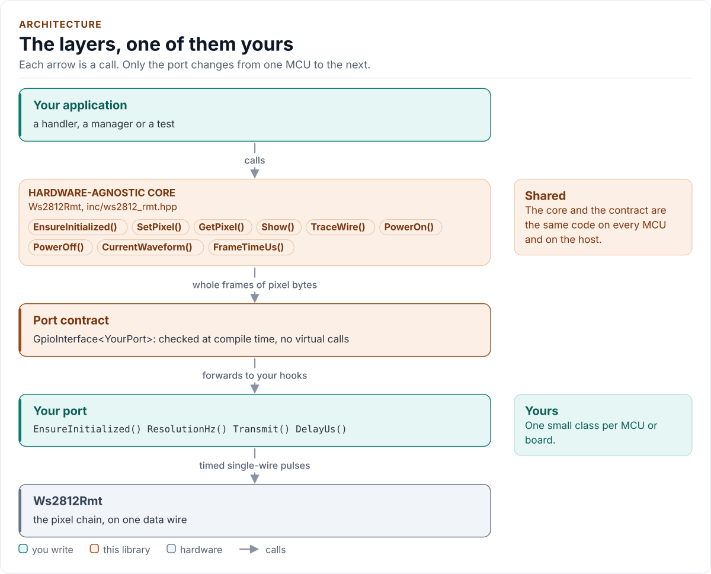
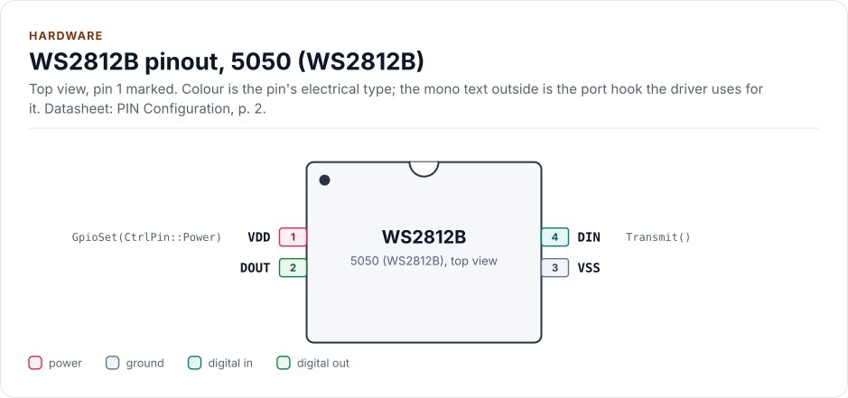
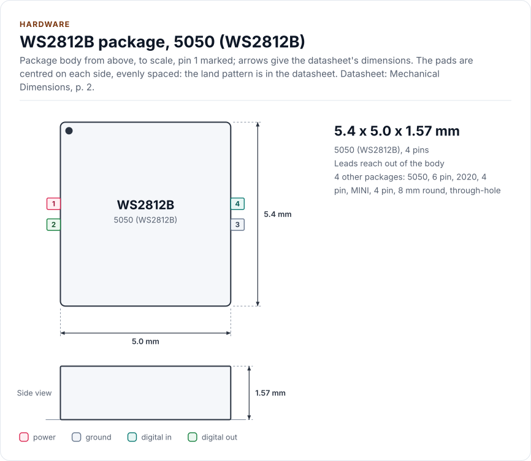
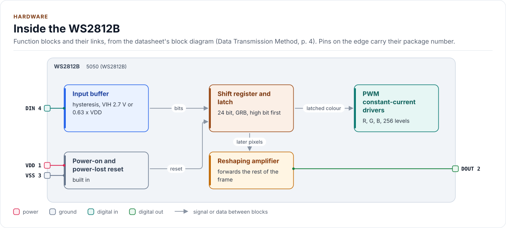

# WS2812_RMT Driver

C++20 driver for single-wire addressable RGB and RGBW LEDs (WS2812, WS2812B, WS2812C, WS2812D and the SK6812 family),
sent as a timed bit stream through a small port class. On ESP32 the port uses the RMT transmitter.

[](https://github.com/kokeb-labs-drivers/driver-ws2812-rmt/actions/workflows/ci.yml)
[](LICENSE)
[](docs/installation.md#requirements)

**Documentation: [`docs/`](docs/index.md)**, with the API reference built by Doxygen ([how](docs/api-reference.md)).
The site at <https://kokeb-labs-drivers.github.io/driver-ws2812-rmt/> opens when the repository is public.

These LEDs have one data wire and no clock: each pixel reads the length of every high pulse as a bit, keeps the
first 24 bits (32 on SK6812RGBW) it sees and forwards the rest. A low longer than the reset time latches the frame.
The datasheets of the parts differ in the allowed pulse lengths, and no single waveform serves every generation of
the WS2812B. This driver keeps the pixels, encodes the byte stream (colour order, brightness, gamma), and works out
the waveform from the windows of the variant you pick and the tick rate your port really runs at. A waveform
outside the windows never reaches the wire. The port sends the bytes, so the core has no SDK, no heap and no
platform code.

<!-- figure: driver-layers -->
<picture>
  <source media="(prefers-color-scheme: dark)" srcset="docs/diagrams/driver-layers.dark.svg">
  
</picture>
<!-- /figure -->

## At a glance

| | |
| --- | --- |
| **Chips** | WS2812, WS2812B (four timing generations), WS2812C, WS2812D-F8, SK6812, SK6812RGBW, SK6812MINI; other single-wire parts with the same frame through `Custom` |
| **Frame** | 24 bits per pixel, GRB, high bit first (32 bits on SK6812RGBW); colour order is a `Config` field |
| **Rate** | About 800 kbit/s; the waveform is resolved at your port's real tick rate (20 MHz or more for a named variant) |
| **Bus** | None of the usual ones: one timed data line, sent by a port (`bus: pio`; on ESP32 the RMT transmitter) |
| **Also drives** | The strip supply or a level shifter's enable, when your port has `GpioSet()` (`PowerOn()`, `PowerOff()`) |
| **Convenience** | Linear brightness, an optional gamma 2.2 table, `ExtractWhite()` and `Wheel()`; no animations |
| **Driver** | Header-only C++20, fixed capacity, no heap, exceptions, RTTI or virtual calls; every call returns `Result<T>` |
| **Runs on** | The core: any MCU. The port: ESP32 (RMT) as an example; the host example runs a simulated strip ([Platforms](docs/platforms.md)) |
| **Status** | 0.1.0, **not verified on hardware**: host-tested against a model written from the datasheets and fuzzed; see [Limitations](docs/limitations.md) |

<!-- figure: chip-pinout -->
<picture>
  <source media="(prefers-color-scheme: dark)" srcset="docs/diagrams/chip-pinout.dark.svg">
  
</picture>
<!-- /figure -->

<!-- figure: chip-outline -->
<picture>
  <source media="(prefers-color-scheme: dark)" srcset="docs/diagrams/chip-outline.dark.svg">
  
</picture>
<!-- /figure -->

<!-- figure: chip-blocks -->
<picture>
  <source media="(prefers-color-scheme: dark)" srcset="docs/diagrams/chip-blocks.dark.svg">
  
</picture>
<!-- /figure -->

<!-- generated: chip-card -->
| | | Datasheet |
| --- | --- | --- |
| **Package** | 5050 (WS2812B) | PIN Configuration, p. 2 |
| **Pins** | 4 | PIN Configuration, p. 2 |
| **Body size** | 5.4 x 5.0 x 1.57 mm | Mechanical Dimensions, p. 2 |
| **Variants** | `p6`, `p2020`, `pmini`, `pf8` (below) | PIN configuration, p. 2 |
| **Supply VDD** | 3.7 V to 5.3 V | Absolute Maximum Ratings, p. 2 |

Also sold as:

| Variant | Package | Pins | Size | Ordering | Note | Datasheet |
| --- | --- | --- | --- | --- | --- | --- |
| `p6` | 5050, 6 pin | 6 | 5050 (drawing) | WS2812, WS2812S | 1 DOUT, 2 DIN, 3 VCC (control supply), 4 NC, 5 VDD (LED supply), 6 VSS | PIN configuration, p. 2 |
| `p2020` | 2020, 4 pin | 4 | 2.0 x 2.0 mm (name) | WS2812B-2020, WS2812C-2020 | 1 DO, 2 GND, 3 DI, 4 VDD | PIN configuration, p. 2 |
| `pmini` | MINI, 4 pin | 4 | 3.5 mm class (drawing) | SK6812MINI, SK6812MINI-E | 1 VDD, 2 DOUT, 3 GND, 4 DIN | PIN configuration, p. 4 |
| `pf8` | 8 mm round, through-hole | 4 | 8 mm diameter | WS2812D-F8 | 1 DOUT, 2 VDD, 3 GND, 4 DIN | PIN configuration, p. 2 |

From [`docs/hardware.yml`](docs/hardware.yml); pins, circuits and the block diagram: [Hardware](docs/hardware.md).
<!-- /generated -->

## Datasheet

<!-- generated: datasheet-card -->
| Document | Revision | Get it |
| --- | --- | --- |
| Datasheet: WS2812 (6 pin) (Worldsemi WS2812) | undated, 2012-10 | [mirror](https://cdn.sparkfun.com/datasheets/Components/LED/WS2812.pdf) |
| Datasheet: WS2812S (6 pin) (Worldsemi WS2812S) | undated, 2013-12 | [mirror](https://static.chipdip.ru/lib/011/DOC013011924.pdf) |
| Datasheet: WS2812B (Worldsemi WS2812B) | undated, 2013-05 | [mirror](https://cdn-shop.adafruit.com/datasheets/WS2812B.pdf) |
| Datasheet: WS2812B (Chinese-language edition) (Worldsemi WS2812B) | undated, 2013-12 | [mirror](https://atta.szlcsc.com/upload/public/pdf/source/20170703/1499049112282.pdf) |
| Datasheet: WS2812B (Worldsemi WS2812B) | Mar-2017, 2017-03 | [mirror](https://www.triopak.fi/files/product/Worldsemi/WS2812B.pdf) |
| Datasheet: WS2812B Ver. No. V5 (Worldsemi WS2812B-V5) | V5.0, 2019-03 | [mirror](https://cdn.eicom.ru/media/PDF/WS2812B-V5.pdf) |
| Datasheet: WS2812B Ver. No. V5 (Watterott copy, revision V6.1) (Worldsemi WS2812B-V5) | V6.1, 2022-09 | [mirror](https://learn.watterott.com/kb/ws281x/WS2812B-v5.pdf) |
| Datasheet: WS2812B-V5/W (Hestore copy, revision V6.0) (Worldsemi WS2812B-V5/W) | V6.0, 2021-12 | no mirror recorded |
| Datasheet: WS2812B-1313-V6 (1313 package) (Worldsemi WS2812B-1313-V6) | V1.0, 2025-10 | no mirror recorded |
| Datasheet: WS2812B-V6 (Worldsemi WS2812B-V6) | V1.1, 2025-10 | [mirror](https://atta.szlcsc.com/upload/public/pdf/source/20251201/45CD695EA06F90F53A3AC4760AC4DC7D.pdf) |
| Datasheet: WS2812B-2020 (Worldsemi WS2812B-2020) | V1.2, 2018-12 | [mirror](https://static.chipdip.ru/lib/471/DOC047471401.pdf) |
| Datasheet: WS2812C (5050, 5 mA) (Worldsemi WS2812C) | V1.0, 2017-05 | [mirror](https://static.chipdip.ru/lib/011/DOC013011928.pdf) |
| Datasheet: Document headed WS2812C, body text WS2812B (Worldsemi WS2812C) | V1.4, 2018-07 | [mirror](https://static.chipdip.ru/lib/622/DOC047622372.pdf) |
| Datasheet: WS2812C-2020 (Worldsemi WS2812C-2020) | V1.0, 2019-03 | [mirror](https://akizukidenshi.com/goodsaffix/ws2812c-2020.pdf) |
| Datasheet: WS2812-2020 (Worldsemi WS2812-2020) | V1.0, 2018-05 | [mirror](https://cdn.shopify.com/s/files/1/2386/9605/files/WS2812-2020_V1.0_EN.pdf) |
| Datasheet: WS2812D-F8 15 mA (8 mm round) (Worldsemi WS2812D-F8) | V1.1, 2018-04 | [mirror](https://static.chipdip.ru/lib/471/DOC047471333.pdf) |
| Datasheet: SK6812 (RGB, 5050) (Opsco SK6812) | Rev. 01, 2015-05 | [mirror](https://cdn-shop.adafruit.com/product-files/1138/SK6812+LED+datasheet+.pdf) |
| Datasheet: SK6812RGBW (Opsco SK6812RGBW) | Rev. 01, 2015-07 | [mirror](https://cdn-shop.adafruit.com/product-files/2757/p2757_SK6812RGBW_REV01.pdf) |
| Datasheet: SK6812RGBX-XX (RGBW) (Opsco SK6812RGBX-XX) | Rev. 03, 2018-07 | [mirror](https://www.ledyilighting.com/wp-content/uploads/2022/02/SK6812-RGBW-LED-specification.pdf) |
| Datasheet: SK6812RGBX-XX (Opsco SK6812RGBX-XX) | Rev. 07, 2019-01 | [mirror](https://ge.voron.ua/files/pdf/Addressed_LEDs/SK6812RGBW-BW/SK6812RGBX-XX_Datasheet.pdf) |
| Datasheet: SK6812MINI-E (Opsco SK6812MINI-E) | Rev. 02, 2019-01 | [mirror](https://cdn-shop.adafruit.com/product-files/4960/4960_SK6812MINI-E_REV02_EN.pdf) |
| Datasheet: SK6812MINIRGBX-XX (mini RGBW) (Opsco SK6812MINIRGBX-XX) | Rev. 01, undated, 2022-11 | [mirror](https://datasheet.sic-components.com/CSPM1411RGBW-IC-6.pdf) |

Written against these revisions; the SHA-256 of each file is in [`docs/datasheets.yml`](docs/datasheets.yml). Where each
part of the driver is in the datasheet: [Datasheet map](docs/datasheet.md).
<!-- /generated -->

Every docs page lists the datasheet sections it relies on, and code comments cite the section they implement. The
vendors publish no direct PDF links, so the documents come from third-party mirrors: the page above says which.

## Try it on your PC

No hardware needed: [`examples/host`](examples/host/README.md) runs the driver against a simulated strip.
You need git, CMake 3.16+ and a C++20 compiler (GCC 10+, Clang 13+ or MSVC 2022).

1. Get the source:

   ```bash
   git clone https://github.com/kokeb-labs-drivers/driver-ws2812-rmt.git && cd driver-ws2812-rmt
   ```

2. Build and run the example:

   ```bash
   cmake -S examples/host -B build-example
   cmake --build build-example
   ./build-example/ws2812_rmt_host_example
   ```

3. You should see a pixel encoded, a rainbow latched by the simulated strip and an RGBW frame:

   ```text
   WS2812_RMT driver 0.1.0 on the host
   frame time 550 us for 8 pixels
   one pixel: 123456 000000
   wire bytes: 34 12 56
   rainbow at brightness 64: 400000 281800 103000 003808 002020 000838 11002F 290017
   violations 0, gaps 0
   RGBW wire (G R B W): 32 96 00 32
   ```

To run the whole test suite instead: `cmake -S . -B build -DWS2812_RMT_BUILD_TESTS=ON && cmake --build build && ctest
--test-dir build`.

## Use it on your MCU

**1. Wire it** ([Hardware](docs/hardware.md) has the pins of every package and the level rules):

| MCU | Strip | Notes |
| --- | --- | --- |
| Timed-output pin | DIN | A 3.3 V output meets the V5.0 and 2025 V6 sheets but not the 0.63 x VDD sheets (3.15 V at 5 V; fails above 5.24 V); older parts and SK6812 need a level shifter too: use one ([Hardware](docs/hardware.md#input-level-and-the-level-shifter)) |
| GPIO (optional) | Supply enable | For `PowerOn()` and `PowerOff()` |
| GND | GND | Common ground with the strip supply |
| | VDD | 5 V, a large capacitor at the strip input and 100 nF at each pixel |

**2. Write the port**: a class with `EnsureInitialized()` (open the channel), `ResolutionHz()` (the rate it really runs
at), `Transmit()` (send the bytes, then hold the line low for the reset) and `DelayUs()`, about 30 lines on most SDKs.
[Porting](docs/porting.md) has the contract; on ESP32 the finished port is in [`examples/esp32`](examples/esp32).

**3. Show a colour:**

<!-- generated: quickstart-code -->
```cpp
#include "ws2812_rmt.hpp"

// 60 pixels of a current WS2812B (V5 or later): the default variant, GRB order.
int32_t light_first_pixel_red() {
  MyPort port;
  ws2812_rmt::Ws2812Rmt<MyPort, 60> strip(port); // owns the pixel and wire buffers; no I/O yet
  if (auto r = strip.EnsureInitialized(); !r) { // 1. channel up, waveform resolved at the real rate
    return static_cast<int32_t>(r.error); //    Bus, or TimingUnreachable for an unsuitable rate
  }
  strip.Clear();                                                          // 2. all pixels black
  static_cast<void>(strip.SetPixel(0, ws2812_rmt::Colour{255, 0, 0, 0})); //    pixel 0 is the first
  if (auto r = strip.Show(); !r) {        // 3. encode, send, wait for the reset
    return static_cast<int32_t>(r.error); //    Bus: the frame was not sent
  }
  return 0;
}
```
<!-- /generated -->

`EnsureInitialized()` is the only call that starts the driver. Every other call that talks to the port returns
`Error::NotInitialized` until it has succeeded. Pick the `Variant` of your LEDs from [Timing](docs/timing.md): the
default is the current WS2812B (V5, V6).

## What it does

- Stores the logical colours, and at `Show()` applies gamma and brightness and writes the bytes in the order you
  declare, in one pass with no allocation.
- Resolves the waveform: the nanosecond windows of the variant, converted to ticks at the real rate, inclusive at the
  edges, with the reset strictly above the minimum. It refuses a rate that cannot meet a window (`TimingUnreachable`).
- Sends nothing before a successful start, nothing after an invalid argument, and stays usable after a failed send.
- Leaves out what is not the chip's: animations, effects and colour-space conversions.
- Returns `Result<T>` with an `Error` from every call: no exceptions, no heap, no RTTI, no virtual calls.

## Add it to your project

Pick the row that matches your build; [Installation](docs/installation.md) has the details.

| Your build | Steps below |
| --- | --- |
| Plain CMake: STM32 (CubeMX), RP2040 (Pico SDK), nRF Connect, a host app | [A](#a-cmake-any-mcu) |
| ESP-IDF | [B](#b-esp-idf) |
| An SDK or OS image that installs libraries | [C](#c-installed-package) |

### A. CMake, any MCU

1. Add the driver as a submodule, pinned to the version you chose:

   ```bash
   git submodule add https://github.com/kokeb-labs-drivers/driver-ws2812-rmt.git external/driver-ws2812-rmt
   ```

2. In your `CMakeLists.txt`, after `project()`:

   ```cmake
   add_subdirectory(external/driver-ws2812-rmt)
   target_link_libraries(my_app PRIVATE ws2812_rmt::ws2812_rmt)   # brings the headers and C++20
   ```

3. In your code, `#include "ws2812_rmt.hpp"`, write the port ([Porting](docs/porting.md)) and build. A first build
   that compiles the quickstart above is the check that the driver is wired in.

### B. ESP-IDF

1. Add the driver under your project's `components/`; ESP-IDF finds it there and names it after the folder:

   ```bash
   git submodule add https://github.com/kokeb-labs-drivers/driver-ws2812-rmt.git components/driver-ws2812-rmt
   ```

2. In `main/CMakeLists.txt`, list it: `idf_component_register(SRCS "main.cpp" REQUIRES driver-ws2812-rmt)`.
3. `idf.py menuconfig` now has a **WS2812_RMT addressable LED driver** menu (the timing generation, the start
   brightness, the reset time), and `idf.py build` builds the driver with your app.
   [`examples/esp32`](examples/esp32) is a complete project with the RMT port.

### C. Installed package

1. Install it once into a prefix:

   ```bash
   cmake -S external/driver-ws2812-rmt -B build-ws2812 && cmake --install build-ws2812 --prefix /opt/sdk
   ```

2. In your project, with `CMAKE_PREFIX_PATH=/opt/sdk`:

   ```cmake
   find_package(ws2812_rmt 0.1 REQUIRED)
   target_link_libraries(my_app PRIVATE ws2812_rmt::ws2812_rmt)
   ```

The target is `ws2812_rmt::ws2812_rmt` every way, so switching later changes nothing else.

## Documentation

| Page | Read it when you want to |
| --- | --- |
| [Quickstart](docs/quickstart.md) | Go from a bare strip to a lit pixel on your MCU |
| [Hardware](docs/hardware.md) | Wire it: packages and pins, input levels, supply, level shifter, capacitors |
| [Timing](docs/timing.md) | Pick the variant of your LEDs, and see how a waveform is resolved |
| [Colour](docs/colour.md) | Set the colour order, brightness and gamma; RGBW |
| [Porting](docs/porting.md) | Write the port class for your MCU's SDK |
| [API guide](docs/api-guide.md) | Use each call: start, set, show, power, handle errors |
| [Configuration](docs/configuration.md) | Choose the variant, the order, the reset, Kconfig or a `Custom` part |
| [Troubleshooting](docs/troubleshooting.md) | Find the cause of a wrong colour, a dark strip or flicker |
| [Limitations](docs/limitations.md) | See what is not covered, what it assumes, and what is not verified |
| [Contract](docs/contract.md) | Know exactly what the driver promises, needs and returns |
| [Datasheet map](docs/datasheet.md) | Find the datasheet section behind each part of the driver |
| [API reference](docs/api-reference.md) | Look up a class or member (Doxygen; built by CI and locally) |

## Tests and quality

```bash
cmake -S . -B build -DWS2812_RMT_BUILD_TESTS=ON && cmake --build build && ctest --test-dir build
```

The host tests run the driver against a model of the pixels written from the datasheets: it decodes the half-symbols
the port received, judges every duration against each document's window and latches frames like a chain of pixels.
A fuzzer chooses the configuration, the tick rate and the port's failures, and checks the driver's promises after
every call. CI also builds for Cortex-M and gates coverage, complexity, sanitizers, fuzzing, clang-tidy, cppcheck and
the handbook rules (`.kokeb/handbook.yml`). See [Testing and CI](docs/testing.md), which lists every gate and its
limit.

## License

MIT. See [LICENSE](LICENSE).
