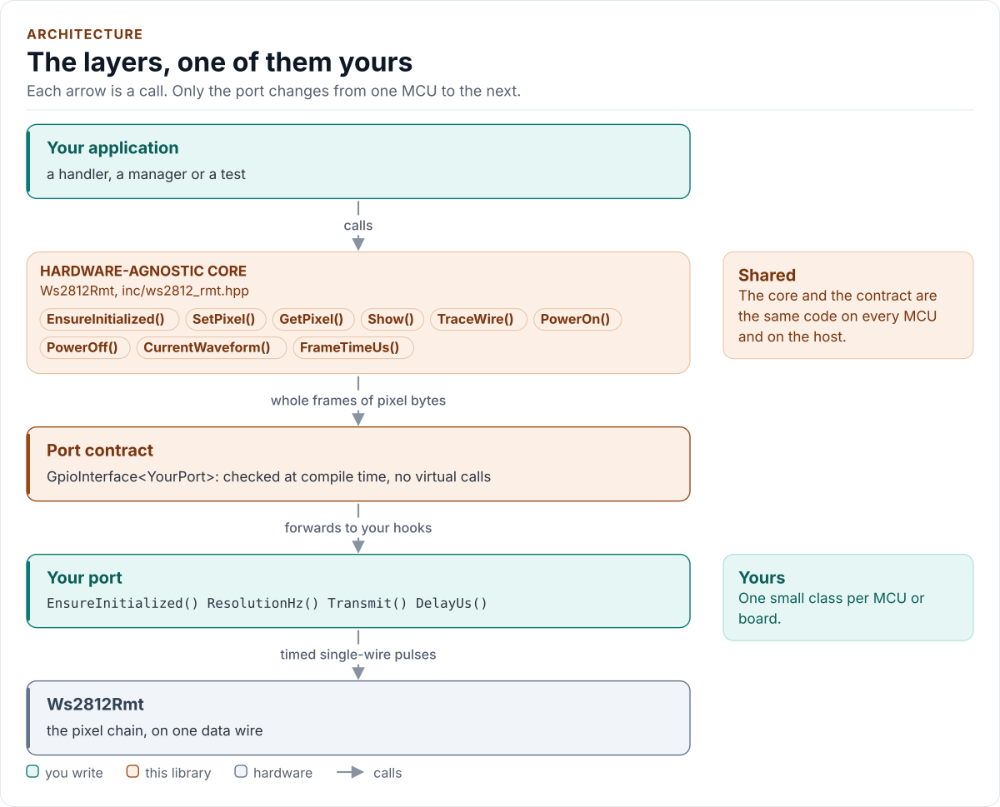

# Architecture

How the driver is built: the core, the port contract, and your port.

<!-- figure: driver-layers -->
<picture>
  <source media="(prefers-color-scheme: dark)" srcset="diagrams/driver-layers.dark.svg">
  
</picture>
<!-- /figure -->

| Layer | Files | Owns |
| --- | --- | --- |
| Core | [`inc/ws2812_rmt.hpp`](../inc/ws2812_rmt.hpp), [`src/ws2812_rmt.ipp`](../src/ws2812_rmt.ipp) | Lifecycle, the pixel and wire buffers, `Show()`, power |
| Pure functions | [`inc/ws2812_rmt_functions.hpp`](../inc/ws2812_rmt_functions.hpp), [`inc/ws2812_rmt_gamma.hpp`](../inc/ws2812_rmt_gamma.hpp) | Waveform resolution, encoding, frame time, `Validate()`, the gamma table |
| Types | [`inc/ws2812_rmt_types.hpp`](../inc/ws2812_rmt_types.hpp) | `Error`, `Result<T>`, `Colour`, `Timing`, the profile table, `Waveform`, `Config` |
| Port contract | [`inc/ws2812_rmt_gpio_interface.hpp`](../inc/ws2812_rmt_gpio_interface.hpp) | The CRTP base, `CtrlPin`, `GpioSignal`, the `Ws2812RmtPort` concept |
| Platform port | Your class | The channel, the tick rate, the stream, optionally the supply pin |

The part has no read-back, so there is no register map and no frame to parse: the core writes a byte stream and
decides what waveform it is sent with. The functions are free `constexpr` functions with no state, so the tests
check each against an independent oracle and a fixed configuration can be proved at build time.

## One call, in order

1. `SetPixel()` and friends store logical colours. No I/O.
2. `Show()` walks the pixels once, applies gamma then brightness, writes the bytes in the configured order into the
   object's wire buffer, and gives the port the span, the resolved waveform and a timeout.
3. The port sends the stream and the reset, and returns `true` or `false`.

The waveform is resolved once, at `EnsureInitialized()`, from the windows and the tick rate. It is not recomputed
per frame, and it is not changed by anything the caller can set after that.

## Why a capacity template argument

The driver owns its buffers (no heap, no caller-owned span that could dangle, handbook KB-CPP20-044), so the capacity
is a template argument. A smaller `Config::pixel_count` uses part of it. One object serves one strip.

Next: [Contract](contract.md).
