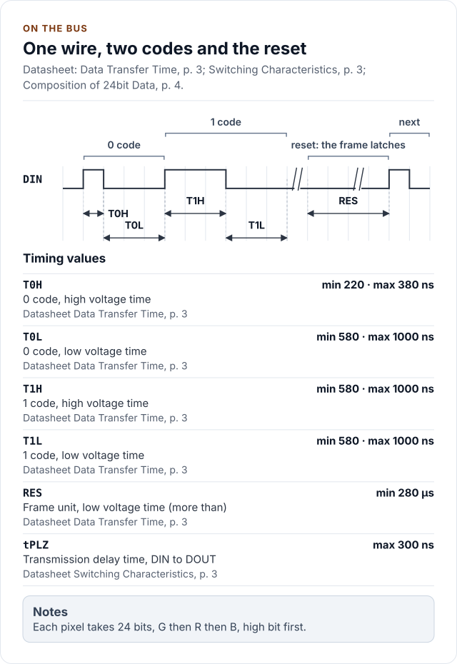
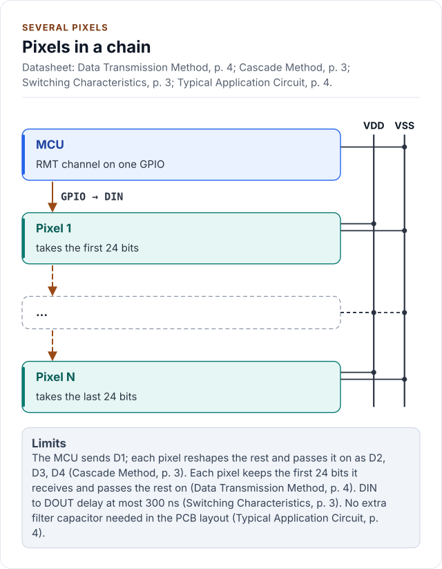

# On the bus

What a chain of pixels needs from its one data wire, with every time taken from the datasheet. The reference is the
WS2812B V5 data sheet (Worldsemi, "WS2812B Ver. No.: V5", revision V5.0, document `b-v5` of the
[Datasheet map](datasheet.md)), whose windows are the default variant `Ws2812bV5`. The windows of every other variant
(older WS2812B sheets, WS2812, WS2812C, WS2812D, SK6812) are on the [Timing](timing.md) page, each with its own
document.

## Single wire

DIN idles low. Each bit is a high pulse followed by a low one, and the length of the high pulse is the value: a short
high is a 0 code, a long high a 1 code. A low longer than the reset time ends the frame and latches the colours.

<!-- figure: single-wire-timing -->
<picture>
  <source media="(prefers-color-scheme: dark)" srcset="diagrams/single-wire-timing.dark.svg">
  
</picture>
<!-- /figure -->

## Several devices

Pixels chain: the MCU drives DIN of the first, and each pixel keeps the first 24 bits it receives and passes the
rest of the frame, reshaped, out of DOUT into the next pixel's DIN. All pixels share VDD and VSS.

<!-- figure: single-wire-chain -->
<picture>
  <source media="(prefers-color-scheme: dark)" srcset="diagrams/single-wire-chain.dark.svg">
  
</picture>
<!-- /figure -->

## How these figures are made

Each figure is a model in `docs/model/` (`single-wire-timing.timing.yml` and `single-wire-chain.topology.yml`) that
cites the datasheet section and page of every number; `kokeb-docs figures` draws it and the build fails on a number
without a citation. The values table under the waveform is also written as `docs/diagrams/<id>.table.html`.
