# Figures

<!-- Written by kokeb-docs figures from docs/diagrams/figures/*.py. Do not edit by hand. -->

Every figure on this site is drawn by a Python module from facts extracted from the code, so it is rebuilt,
not redrawn, when the code changes. CI runs `kokeb-docs figures --check` and fails when a
committed figure no longer matches the code. Each figure below lists the files it is drawn from.

## Inside the WS2812B

<!-- figure: chip-blocks -->
<picture>
  <source media="(prefers-color-scheme: dark)" srcset="chip-blocks.dark.svg">
  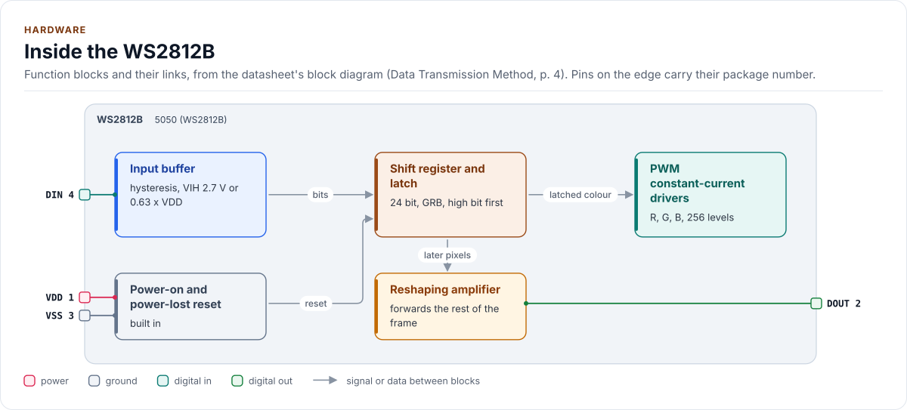
</picture>
<!-- /figure -->

Hardware description: [`docs/hardware.yml`](../hardware.yml)

Drawn from:

- [`docs/hardware.yml`](../hardware.yml)
- [`inc/ws2812_rmt.hpp`](../../inc/ws2812_rmt.hpp)
- [`inc/ws2812_rmt_gpio_interface.hpp`](../../inc/ws2812_rmt_gpio_interface.hpp)

## What the WS2812B does

<!-- figure: chip-capabilities -->
<picture>
  <source media="(prefers-color-scheme: dark)" srcset="chip-capabilities.dark.svg">
  
</picture>
<!-- /figure -->

Hardware description: [`docs/hardware.yml`](../hardware.yml)

Drawn from:

- [`docs/hardware.yml`](../hardware.yml)
- [`inc/ws2812_rmt.hpp`](../../inc/ws2812_rmt.hpp)
- [`inc/ws2812_rmt_gpio_interface.hpp`](../../inc/ws2812_rmt_gpio_interface.hpp)

## WS2812B: Direct data line

<!-- figure: chip-circuit-direct -->
<picture>
  <source media="(prefers-color-scheme: dark)" srcset="chip-circuit-direct.dark.svg">
  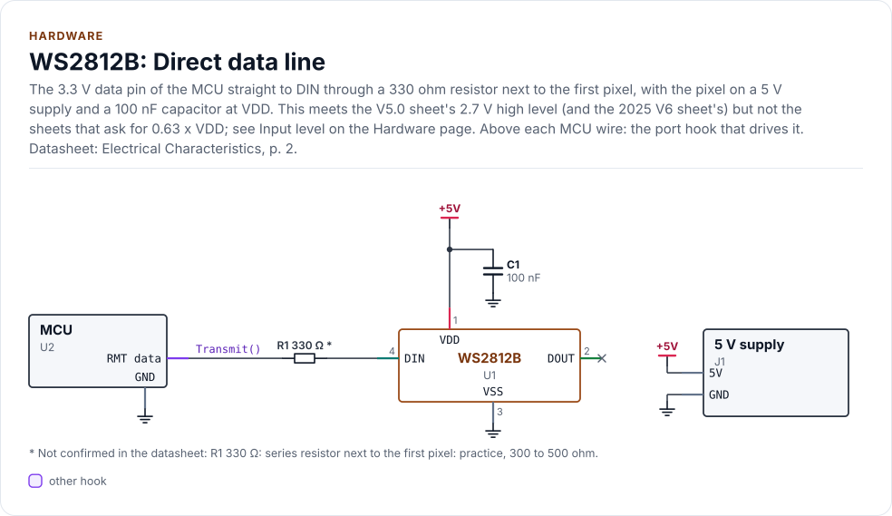
</picture>
<!-- /figure -->

Hardware description: [`docs/hardware.yml`](../hardware.yml)

Drawn from:

- [`docs/hardware.yml`](../hardware.yml)
- [`inc/ws2812_rmt.hpp`](../../inc/ws2812_rmt.hpp)
- [`inc/ws2812_rmt_gpio_interface.hpp`](../../inc/ws2812_rmt_gpio_interface.hpp)

## WS2812B: Level shifter for a 3.3 V MCU, supply always on

<!-- figure: chip-circuit-shifted -->
<picture>
  <source media="(prefers-color-scheme: dark)" srcset="chip-circuit-shifted.dark.svg">
  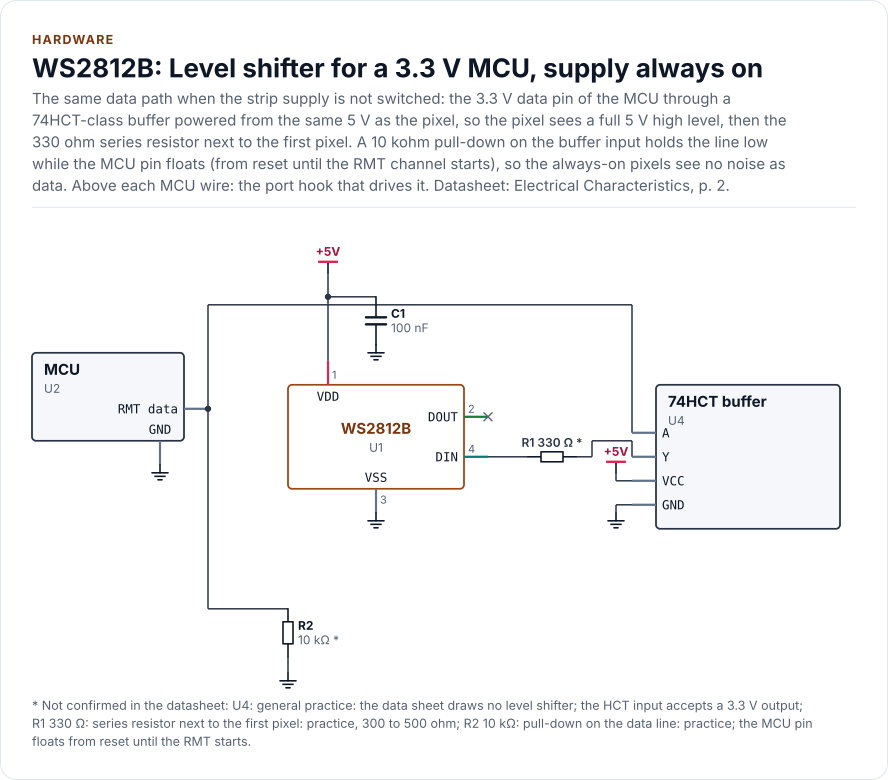
</picture>
<!-- /figure -->

Hardware description: [`docs/hardware.yml`](../hardware.yml)

Drawn from:

- [`docs/hardware.yml`](../hardware.yml)
- [`inc/ws2812_rmt.hpp`](../../inc/ws2812_rmt.hpp)
- [`inc/ws2812_rmt_gpio_interface.hpp`](../../inc/ws2812_rmt_gpio_interface.hpp)

## WS2812B: Typical application

<!-- figure: chip-circuit-typical -->
<picture>
  <source media="(prefers-color-scheme: dark)" srcset="chip-circuit-typical.dark.svg">
  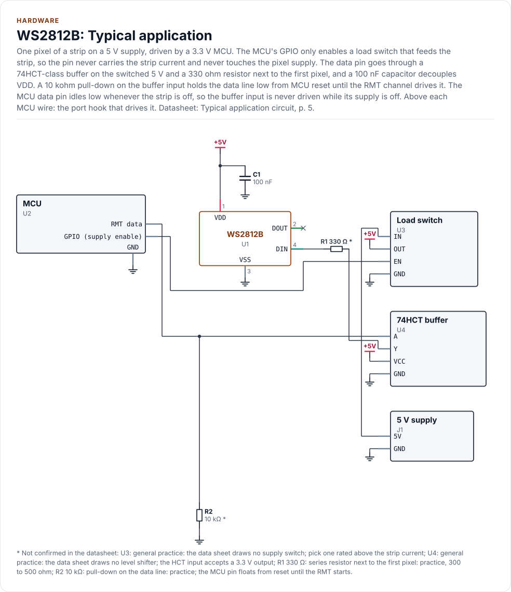
</picture>
<!-- /figure -->

Hardware description: [`docs/hardware.yml`](../hardware.yml)

Drawn from:

- [`docs/hardware.yml`](../hardware.yml)
- [`inc/ws2812_rmt.hpp`](../../inc/ws2812_rmt.hpp)
- [`inc/ws2812_rmt_gpio_interface.hpp`](../../inc/ws2812_rmt_gpio_interface.hpp)

## WS2812B: Pixel data

<!-- figure: chip-frame-pixel -->
<picture>
  <source media="(prefers-color-scheme: dark)" srcset="chip-frame-pixel.dark.svg">
  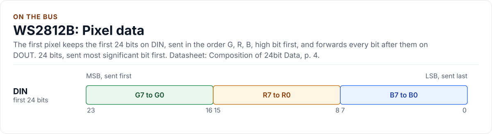
</picture>
<!-- /figure -->

Hardware description: [`docs/hardware.yml`](../hardware.yml)

Drawn from:

- [`docs/hardware.yml`](../hardware.yml)
- [`inc/ws2812_rmt.hpp`](../../inc/ws2812_rmt.hpp)
- [`inc/ws2812_rmt_gpio_interface.hpp`](../../inc/ws2812_rmt_gpio_interface.hpp)

## WS2812B

<!-- figure: chip-hero -->
<picture>
  <source media="(prefers-color-scheme: dark)" srcset="chip-hero.dark.svg">
  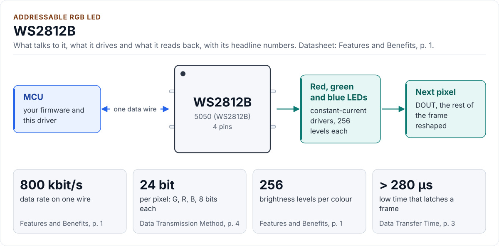 280 µs low time that latches a frame.">
</picture>
<!-- /figure -->

Hardware description: [`docs/hardware.yml`](../hardware.yml)

Drawn from:

- [`docs/hardware.yml`](../hardware.yml)
- [`inc/ws2812_rmt.hpp`](../../inc/ws2812_rmt.hpp)
- [`inc/ws2812_rmt_gpio_interface.hpp`](../../inc/ws2812_rmt_gpio_interface.hpp)

## WS2812B package, 5050 (WS2812B)

<!-- figure: chip-outline -->
<picture>
  <source media="(prefers-color-scheme: dark)" srcset="chip-outline.dark.svg">
  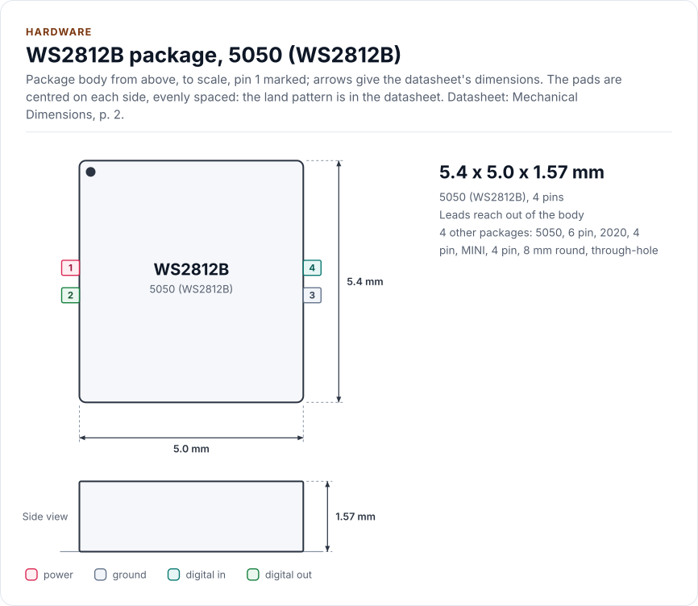
</picture>
<!-- /figure -->

Hardware description: [`docs/hardware.yml`](../hardware.yml)

Drawn from:

- [`docs/hardware.yml`](../hardware.yml)
- [`inc/ws2812_rmt.hpp`](../../inc/ws2812_rmt.hpp)
- [`inc/ws2812_rmt_gpio_interface.hpp`](../../inc/ws2812_rmt_gpio_interface.hpp)

## WS2812B pinout, 5050 (WS2812B)

<!-- figure: chip-pinout -->
<picture>
  <source media="(prefers-color-scheme: dark)" srcset="chip-pinout.dark.svg">
  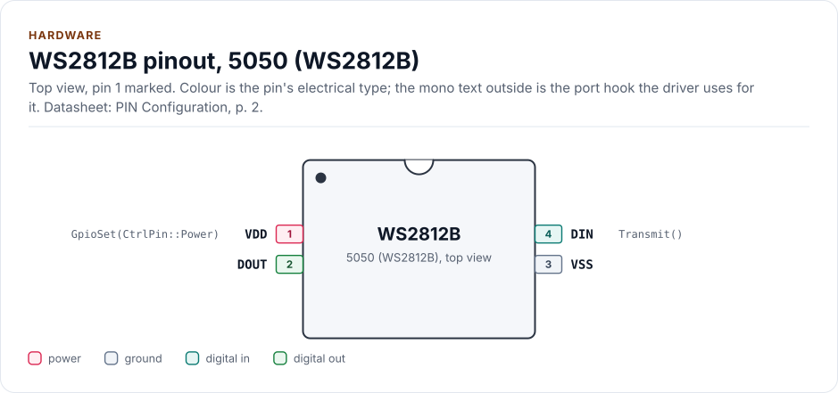
</picture>
<!-- /figure -->

Hardware description: [`docs/hardware.yml`](../hardware.yml)

Drawn from:

- [`docs/hardware.yml`](../hardware.yml)
- [`inc/ws2812_rmt.hpp`](../../inc/ws2812_rmt.hpp)
- [`inc/ws2812_rmt_gpio_interface.hpp`](../../inc/ws2812_rmt_gpio_interface.hpp)

## Wiring: Direct data line

<!-- figure: chip-wiring-direct -->
<picture>
  <source media="(prefers-color-scheme: dark)" srcset="chip-wiring-direct.dark.svg">
  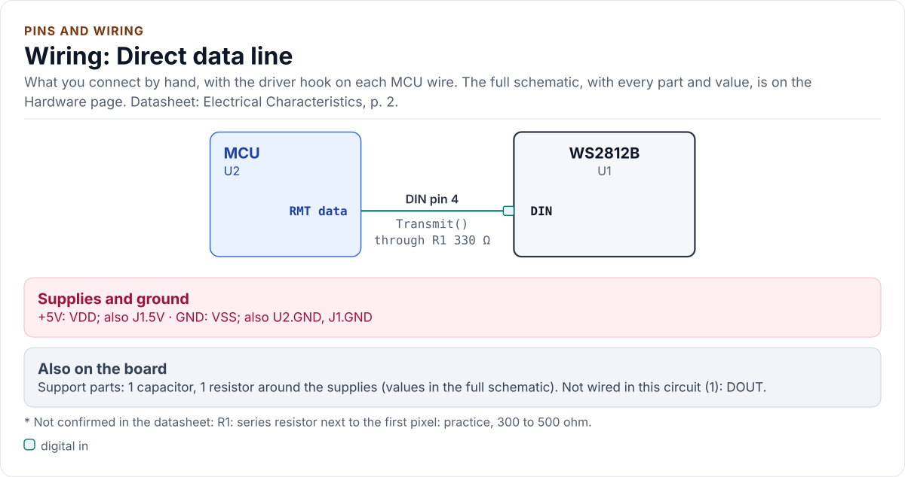
</picture>
<!-- /figure -->

Hardware description: [`docs/hardware.yml`](../hardware.yml)

Drawn from:

- [`docs/hardware.yml`](../hardware.yml)
- [`inc/ws2812_rmt.hpp`](../../inc/ws2812_rmt.hpp)
- [`inc/ws2812_rmt_gpio_interface.hpp`](../../inc/ws2812_rmt_gpio_interface.hpp)

## Wiring: Level shifter for a 3.3 V MCU, supply always on

<!-- figure: chip-wiring-shifted -->
<picture>
  <source media="(prefers-color-scheme: dark)" srcset="chip-wiring-shifted.dark.svg">
  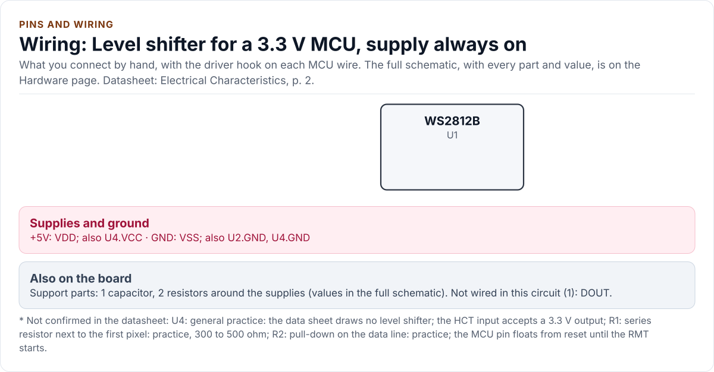
</picture>
<!-- /figure -->

Hardware description: [`docs/hardware.yml`](../hardware.yml)

Drawn from:

- [`docs/hardware.yml`](../hardware.yml)
- [`inc/ws2812_rmt.hpp`](../../inc/ws2812_rmt.hpp)
- [`inc/ws2812_rmt_gpio_interface.hpp`](../../inc/ws2812_rmt_gpio_interface.hpp)

## Wiring: Typical application

<!-- figure: chip-wiring-typical -->
<picture>
  <source media="(prefers-color-scheme: dark)" srcset="chip-wiring-typical.dark.svg">
  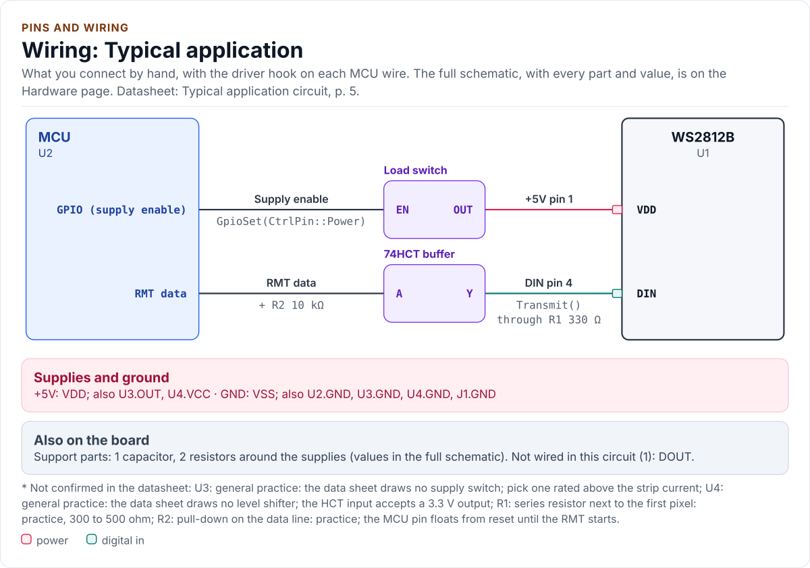
</picture>
<!-- /figure -->

Hardware description: [`docs/hardware.yml`](../hardware.yml)

Drawn from:

- [`docs/hardware.yml`](../hardware.yml)
- [`inc/ws2812_rmt.hpp`](../../inc/ws2812_rmt.hpp)
- [`inc/ws2812_rmt_gpio_interface.hpp`](../../inc/ws2812_rmt_gpio_interface.hpp)

## The layers, one of them yours

<!-- figure: driver-layers -->
<picture>
  <source media="(prefers-color-scheme: dark)" srcset="driver-layers.dark.svg">
  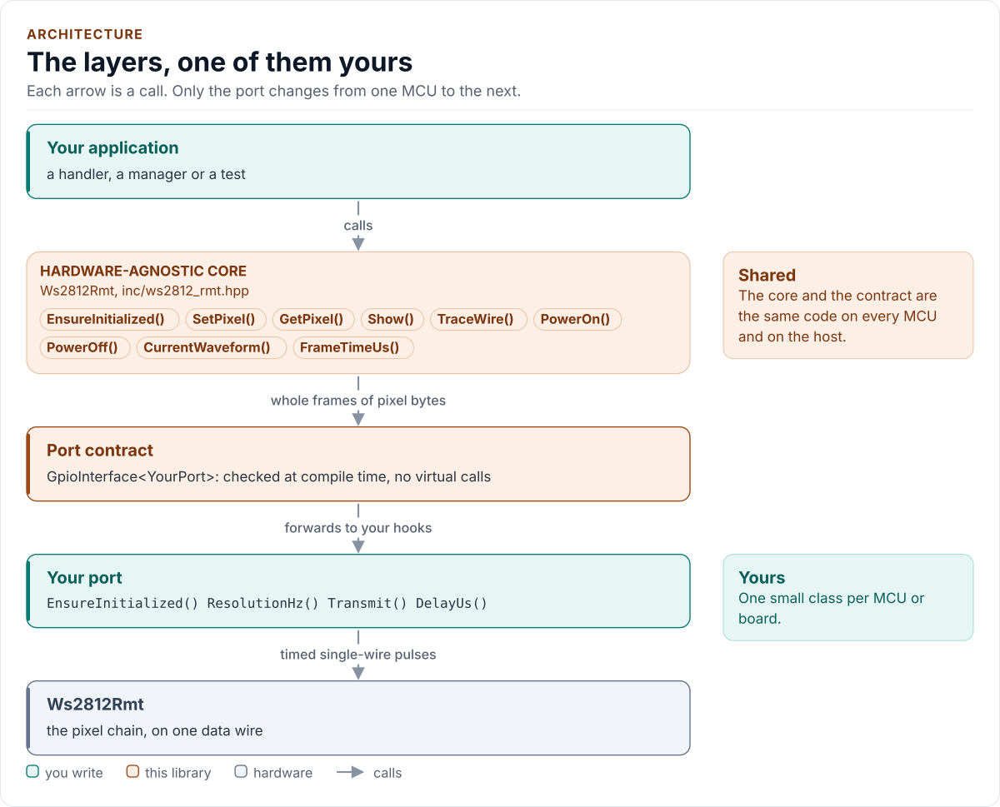
</picture>
<!-- /figure -->

Figure module: [`docs/diagrams/figures/driver-layers.py`](../../docs/diagrams/figures/driver-layers.py)

Drawn from:

- `public calls` in [`inc/ws2812_rmt.hpp`](../../inc/ws2812_rmt.hpp)
- `GpioInterface` in [`inc/ws2812_rmt_gpio_interface.hpp`](../../inc/ws2812_rmt_gpio_interface.hpp)
