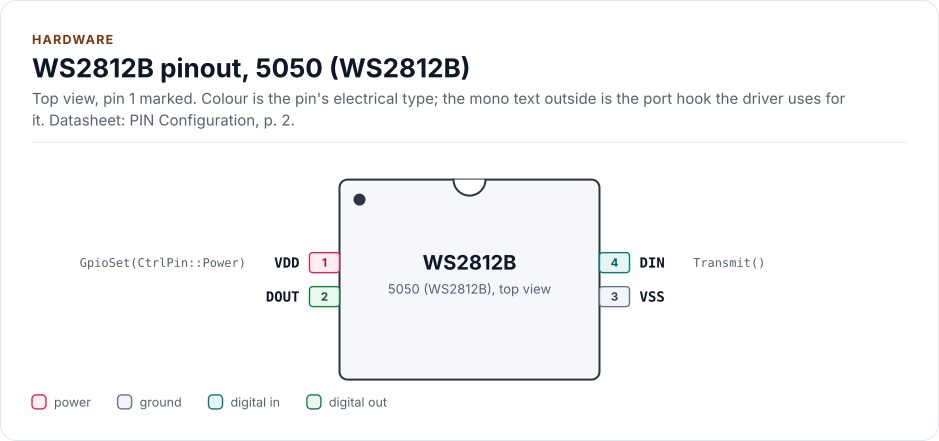
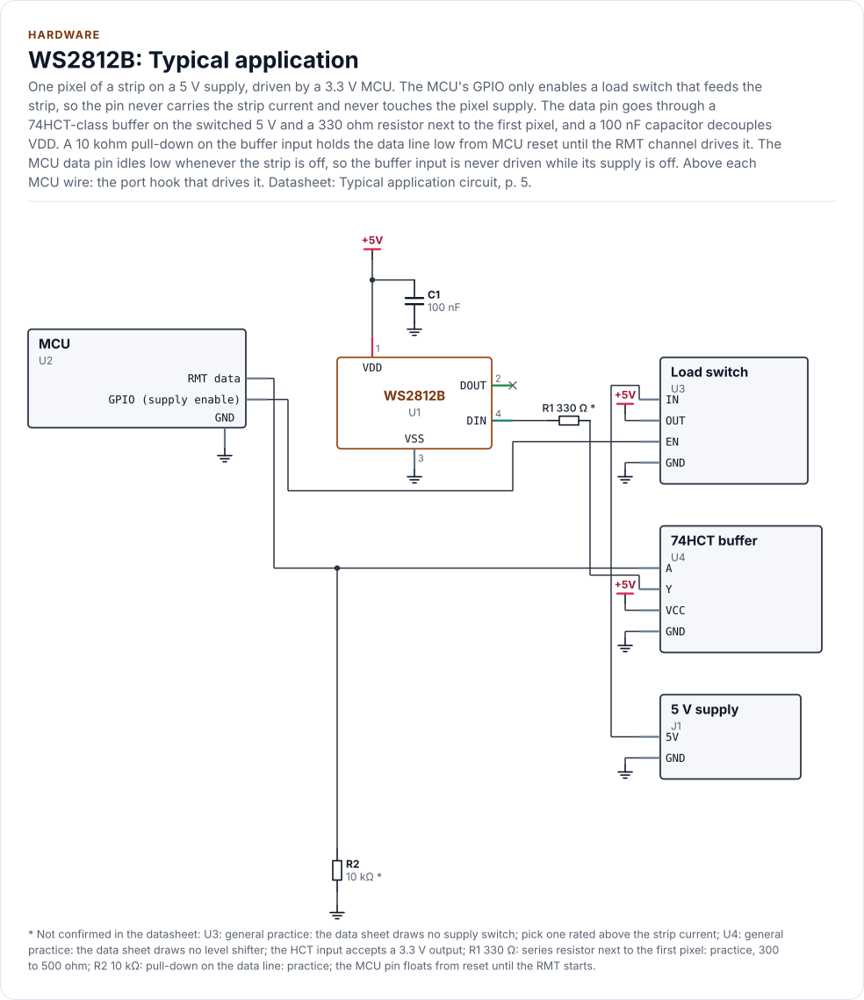
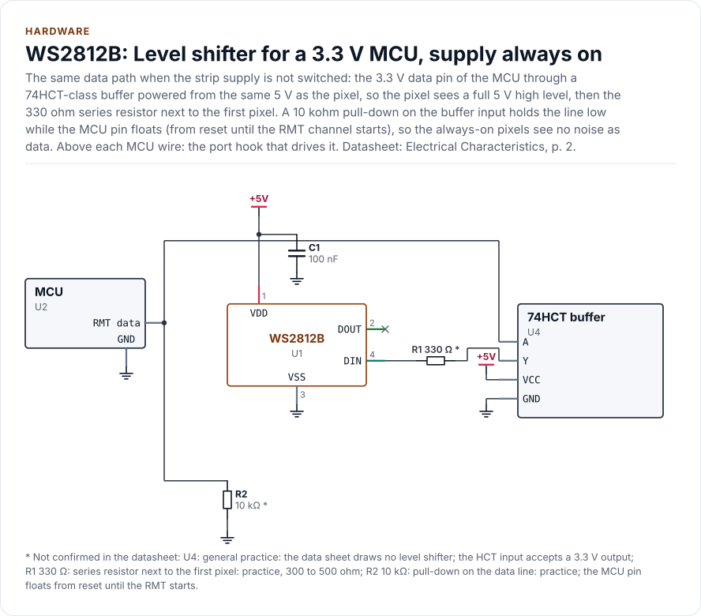
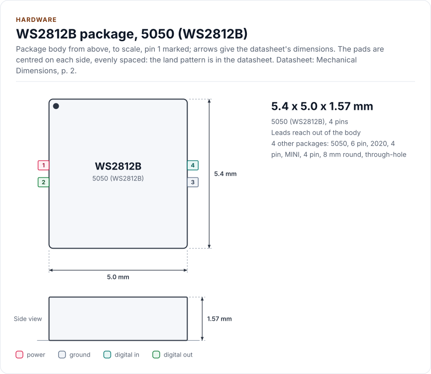
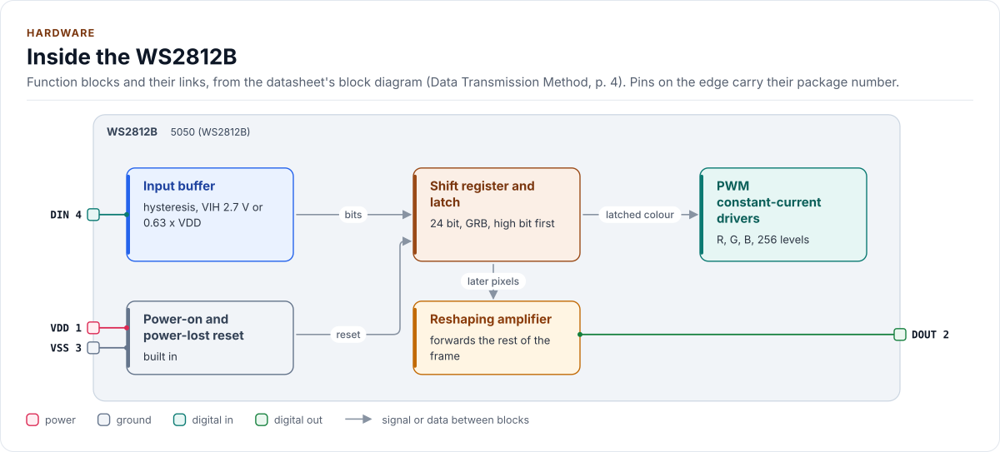

# Hardware

The strip's pins, input levels, supply and wiring, as the driver uses them. The chip is a family of parts with the
same four signals; the pin order and the levels differ per part.

<!-- generated: datasheet-refs -->
??? abstract "Datasheet sections this page relies on"

    - Pins and package: six pin 5050: Worldsemi WS2812 undated, PIN configuration, p. 2
    - Typical application circuit: Worldsemi WS2812B undated, Typical application circuit, p. 5
    - Input levels VIH and VIL: Worldsemi WS2812B-V5 V5.0, Electrical Characteristics, p. 2
    - Supply range and logical input voltage: Worldsemi WS2812B-V5 V5.0, Absolute Maximum Ratings, p. 2
    - Pins and package: four pin 5050: Worldsemi WS2812B-V5 V5.0, PIN Configuration, p. 2
    - Propagation delay DIN to DOUT: Worldsemi WS2812B-V5 V5.0, Switching Characteristics, p. 3
    - Input level 0.63 x VDD (later V5 family sheets): Worldsemi WS2812B-V5 V6.1, Electrical Characteristics, p. 3
    - Input levels of the SK6812: Opsco SK6812RGBW Rev. 01, Electrical Characteristics, p. 4

    All of them, with the driver API for each: [Datasheet map](datasheet.md).
<!-- /generated -->

## Pins

Every part has DIN (data from the controller), DOUT (data to the next pixel), VDD and VSS. The six-pin parts add a
separate control supply. The pin numbers differ between parts, so check the drawing of your part's datasheet:

| Package | Parts | Pins | Datasheet |
| --- | --- | --- | --- |
| 5050, 4 pin, 5.0 x 5.4 x 1.57 mm | WS2812B, WS2812C, WS2812B V5 and V6 | 1 VDD, 2 DOUT, 3 VSS, 4 DIN | V5, p. 2 |
| 5050, 6 pin | WS2812, WS2812S | 1 DOUT, 2 DIN, 3 VCC (control supply), 4 NC, 5 VDD (LED supply), 6 VSS | WS2812, p. 2 |
| 2020, 4 pin | WS2812B-2020, WS2812C-2020, WS2812-2020 | 1 DO, 2 GND, 3 DI, 4 VDD | WS2812B-2020, p. 2 |
| MINI, 4 pin | SK6812MINI, SK6812MINI-E | 1 VDD, 2 DOUT, 3 GND, 4 DIN | SK6812MINI-E, p. 4 |
| 8 mm round, through-hole | WS2812D-F8 | 1 DOUT, 2 VDD, 3 GND, 4 DIN | WS2812D-F8, p. 2 |
| 5050 (SK6812) | SK6812, SK6812RGBW | the Rev 01 sheet and the later revisions list different orders | see below |

The SK6812 Rev 01 sheet disagrees with its own later revisions on the pin order of the 5050 package. Trust the
silkscreen or the drawing of the sheet that matches your strip, and where they differ test one pixel before wiring a
strip. The driver does not depend on the pin order: DIN is whatever pin your port drives.

<!-- figure: chip-pinout -->
<picture>
  <source media="(prefers-color-scheme: dark)" srcset="diagrams/chip-pinout.dark.svg">
  
</picture>
<!-- /figure -->

<!-- generated: chip-pins -->
5050 (WS2812B), 4 pins (PIN Configuration, p. 2).

| Pin | Name | Type (domain) | Function | Driver hook | If unused | Datasheet |
| --- | --- | --- | --- | --- | --- | --- |
| 1 | `VDD` | power (VDD) | Supply, 3.7 V to 5.3 V; switched through the optional hook | `GpioSet(CtrlPin::Power)` | - | PIN Configuration, p. 2 |
| 2 | `DOUT` | digital out (VDD) | Reshaped data to the next pixel (300 ns propagation at most) | - | Leave open on the last pixel | Data Transmission Method, p. 4 |
| 3 | `VSS` | ground | Ground, data and power | - | - | PIN Configuration, p. 2 |
| 4 | `DIN` | digital in (VDD) | Data in: the timed bit stream; high level at least 2.7 V (V5.0) or 0.63 x VDD (later sheets): see Input level | `Transmit()` | - | Electrical Characteristics, p. 2 |

Source of this table and of the chip figures: [`docs/hardware.yml`](hardware.yml).
<!-- /generated -->

## Input level and the level shifter

The data input has a threshold that depends on the part and on the revision of its datasheet. `MinLogicHighMv(variant,
vdd_mv)` returns the minimum input high level the variant requires: for a variant built from several documents, the
strictest of them. Use it in a check of your wiring.

| Part and datasheet revision | Input high level VIH | At VDD = 5 V | A 3.3 V output |
| --- | --- | --- | --- |
| WS2812B V5.0, WS2812B-2020, WS2812C-2020 | 2.7 V fixed | 2.7 V | meets it |
| WS2812B V6.0 (2021) and V6.1 (2022), the Hestore and Watterott copies | 0.63 x VDD | 3.15 V | does **not** meet it above about 5.24 V |
| WS2812B-V6 (2025) | 0.55 x VDD | 2.75 V | meets it |
| WS2812, WS2812B 2013 to 2017, WS2812C, WS2812D | 0.7 x VDD | 3.5 V | does **not** meet it |
| SK6812RGBW Rev 01 and Rev 03 | 3.4 V minimum | 3.4 V | does **not** meet it |
| SK6812 RGB Rev 01 | 3.4 V, printed as typical (no minimum) | 3.4 V | does **not** meet it |
| SK6812RGBX Rev 07, SK6812MINI, SK6812MINI-E | 0.7 x VDD | 3.5 V | does **not** meet it |

For `Sk6812` and `Sk6812Rgbw`, `MinLogicHighMv()` returns the larger of 3.4 V and 0.7 x VDD. For the RGB part the
0.7 x VDD is the driver's choice (its only sheet prints a typical 3.4 V and no minimum), taken from the other sheets
of the family.

The `Ws2812bV5` profile covers V5.0 to V6.1 and the 2025 sheet, so it returns the strictest: 3150 mV at 5 V, 3339 mV
at 5.3 V, 2700 mV at 3.7 V or 3.3 V. A strip whose sheet you cannot identify is safest treated by that value: 3.3 V
meets the V5.0 and 2025 V6 sheets, and the 0.63 x VDD sheets only up to about 5.24 V of supply.

Where the output does not meet it, put a buffer with a 5 V supply between the MCU and the first pixel (a gate with
TTL-compatible inputs, or a level shifter). Where it meets it on paper, the margin is small: the strip supply can sit
above 5 V under load, and a long wire adds noise. A shifter is cheap insurance on every strip. The input low level is
0.7 V at most for V5 and later, 0.3 x VDD for the older parts.

## Supply

| Part | VDD (absolute maximum) | Pixel current |
| --- | --- | --- |
| WS2812B 2013 to 2017, WS2812C | 3.5 V to 5.3 V | 20 mA per colour (C: 5 mA) |
| WS2812B V5, WS2812B-2020, WS2812C-2020, WS2812D | 3.7 V to 5.3 V | 12 mA per colour as a test condition (D-F8: 15 mA) |
| WS2812B V6 | 3.3 V to 5.3 V | per datasheet |
| SK6812 | 3.5 V to 5.5 V (MINI: 3.7 V to 5.5 V) | 12 mA test condition |
| WS2812 (6 pin) | printed as 6.0 V to 7.0 V; looks like a misprint of a limit | 20 mA per colour |

Budget the supply for the worst case: all three channels at full on every pixel is about 60 mA per pixel for a
20 mA part (so 60 pixels need about 3.6 A) and about 36 mA for a 12 mA part. Use `SetBrightness()` to stay inside
the supply you have. The quiescent current is small (about 0.6 mA for V5, 1 uA for V6, 1 mA for SK6812).

## Wiring advice

These are the application notes of the datasheets and the usual practice; none is checked by the driver.

- A capacitor of 100 nF between VDD and VSS at every pixel (the typical application circuit of the datasheet), and a
  large electrolytic capacitor across the supply where the strip is fed.
- A series resistor of 300 to 500 ohm in the data line, close to the first pixel, damps ringing on a long wire. The
  V5 datasheet lists "no extra filter capacitor needed" in its circuit.
- Connect ground first and keep the data wire short and next to its ground. Never drive DIN of an unpowered strip:
  the input diode back-feeds the supply. Switch the supply with `PowerOff()` and do not call `Show()` while it is off.
- Feed a long strip from several points: the voltage drop along the strip dims and tints the far end.
- Mixed generations in one chain need one waveform that is legal for all of them, which may not exist:
  [Timing](timing.md#mixed-chains).

<!-- figure: chip-circuit-typical -->
<picture>
  <source media="(prefers-color-scheme: dark)" srcset="diagrams/chip-circuit-typical.dark.svg">
  
</picture>
<!-- /figure -->

<!-- figure: chip-circuit-shifted -->
<picture>
  <source media="(prefers-color-scheme: dark)" srcset="diagrams/chip-circuit-shifted.dark.svg">
  
</picture>
<!-- /figure -->

## Package and blocks

<!-- figure: chip-outline -->
<picture>
  <source media="(prefers-color-scheme: dark)" srcset="diagrams/chip-outline.dark.svg">
  
</picture>
<!-- /figure -->

<!-- figure: chip-blocks -->
<picture>
  <source media="(prefers-color-scheme: dark)" srcset="diagrams/chip-blocks.dark.svg">
  
</picture>
<!-- /figure -->

The data path inside each pixel is one chain: input buffer, a shift register that keeps the first 24 (or 32) bits it
receives, a latch that takes them when a reset low arrives, constant-current PWM drivers with 256 levels per channel,
and a reshaping amplifier that regenerates the rest of the frame for the next pixel (up to 300 ns of delay at most,
500 ns for SK6812). A power-on and power-lost reset is built in; no datasheet gives its duration (the
`Config::power_on_settle_us` knob is an assumption, see [Limitations](limitations.md)).

## Reference documents

Every pin, level and timing on this page cites a section of the datasheets in
[`docs/datasheets.yml`](datasheets.yml), which lists each file's revision, mirror URL and SHA-256.

<!-- generated: datasheet-card -->
| Document | Revision | Get it |
| --- | --- | --- |
| Datasheet: WS2812 (6 pin) (Worldsemi WS2812) | undated, 2012-10 | [mirror](https://cdn.sparkfun.com/datasheets/Components/LED/WS2812.pdf) |
| Datasheet: WS2812S (6 pin) (Worldsemi WS2812S) | undated, 2013-12 | [mirror](https://static.chipdip.ru/lib/011/DOC013011924.pdf) |
| Datasheet: WS2812B (Worldsemi WS2812B) | undated, 2013-05 | [mirror](https://cdn-shop.adafruit.com/datasheets/WS2812B.pdf) |
| Datasheet: WS2812B (Chinese-language edition) (Worldsemi WS2812B) | undated, 2013-12 | [mirror](https://atta.szlcsc.com/upload/public/pdf/source/20170703/1499049112282.pdf) |
| Datasheet: WS2812B (Worldsemi WS2812B) | Mar-2017, 2017-03 | [mirror](https://www.triopak.fi/files/product/Worldsemi/WS2812B.pdf) |
| Datasheet: WS2812B Ver. No. V5 (Worldsemi WS2812B-V5) | V5.0, 2019-03 | [mirror](https://cdn.eicom.ru/media/PDF/WS2812B-V5.pdf) |
| Datasheet: WS2812B Ver. No. V5 (Watterott copy, revision V6.1) (Worldsemi WS2812B-V5) | V6.1, 2022-09 | [mirror](https://learn.watterott.com/kb/ws281x/WS2812B-v5.pdf) |
| Datasheet: WS2812B-V5/W (Hestore copy, revision V6.0) (Worldsemi WS2812B-V5/W) | V6.0, 2021-12 | no mirror recorded |
| Datasheet: WS2812B-1313-V6 (1313 package) (Worldsemi WS2812B-1313-V6) | V1.0, 2025-10 | no mirror recorded |
| Datasheet: WS2812B-V6 (Worldsemi WS2812B-V6) | V1.1, 2025-10 | [mirror](https://atta.szlcsc.com/upload/public/pdf/source/20251201/45CD695EA06F90F53A3AC4760AC4DC7D.pdf) |
| Datasheet: WS2812B-2020 (Worldsemi WS2812B-2020) | V1.2, 2018-12 | [mirror](https://static.chipdip.ru/lib/471/DOC047471401.pdf) |
| Datasheet: WS2812C (5050, 5 mA) (Worldsemi WS2812C) | V1.0, 2017-05 | [mirror](https://static.chipdip.ru/lib/011/DOC013011928.pdf) |
| Datasheet: Document headed WS2812C, body text WS2812B (Worldsemi WS2812C) | V1.4, 2018-07 | [mirror](https://static.chipdip.ru/lib/622/DOC047622372.pdf) |
| Datasheet: WS2812C-2020 (Worldsemi WS2812C-2020) | V1.0, 2019-03 | [mirror](https://akizukidenshi.com/goodsaffix/ws2812c-2020.pdf) |
| Datasheet: WS2812-2020 (Worldsemi WS2812-2020) | V1.0, 2018-05 | [mirror](https://cdn.shopify.com/s/files/1/2386/9605/files/WS2812-2020_V1.0_EN.pdf) |
| Datasheet: WS2812D-F8 15 mA (8 mm round) (Worldsemi WS2812D-F8) | V1.1, 2018-04 | [mirror](https://static.chipdip.ru/lib/471/DOC047471333.pdf) |
| Datasheet: SK6812 (RGB, 5050) (Opsco SK6812) | Rev. 01, 2015-05 | [mirror](https://cdn-shop.adafruit.com/product-files/1138/SK6812+LED+datasheet+.pdf) |
| Datasheet: SK6812RGBW (Opsco SK6812RGBW) | Rev. 01, 2015-07 | [mirror](https://cdn-shop.adafruit.com/product-files/2757/p2757_SK6812RGBW_REV01.pdf) |
| Datasheet: SK6812RGBX-XX (RGBW) (Opsco SK6812RGBX-XX) | Rev. 03, 2018-07 | [mirror](https://www.ledyilighting.com/wp-content/uploads/2022/02/SK6812-RGBW-LED-specification.pdf) |
| Datasheet: SK6812RGBX-XX (Opsco SK6812RGBX-XX) | Rev. 07, 2019-01 | [mirror](https://ge.voron.ua/files/pdf/Addressed_LEDs/SK6812RGBW-BW/SK6812RGBX-XX_Datasheet.pdf) |
| Datasheet: SK6812MINI-E (Opsco SK6812MINI-E) | Rev. 02, 2019-01 | [mirror](https://cdn-shop.adafruit.com/product-files/4960/4960_SK6812MINI-E_REV02_EN.pdf) |
| Datasheet: SK6812MINIRGBX-XX (mini RGBW) (Opsco SK6812MINIRGBX-XX) | Rev. 01, undated, 2022-11 | [mirror](https://datasheet.sic-components.com/CSPM1411RGBW-IC-6.pdf) |

Written against these revisions; the SHA-256 of each file is in [`docs/datasheets.yml`](datasheets.yml). Where each part
of the driver is in the datasheet: [Datasheet map](datasheet.md).
<!-- /generated -->
