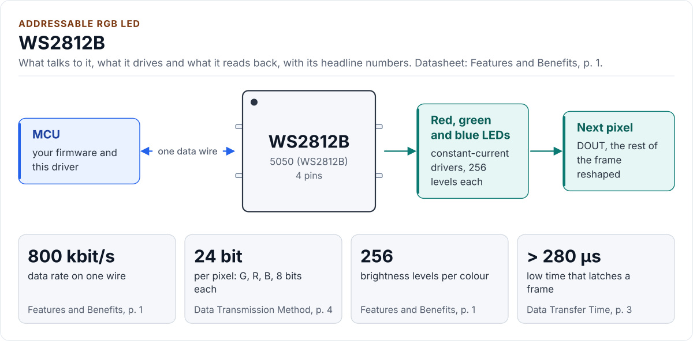
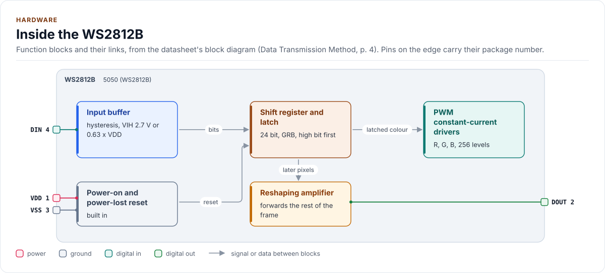
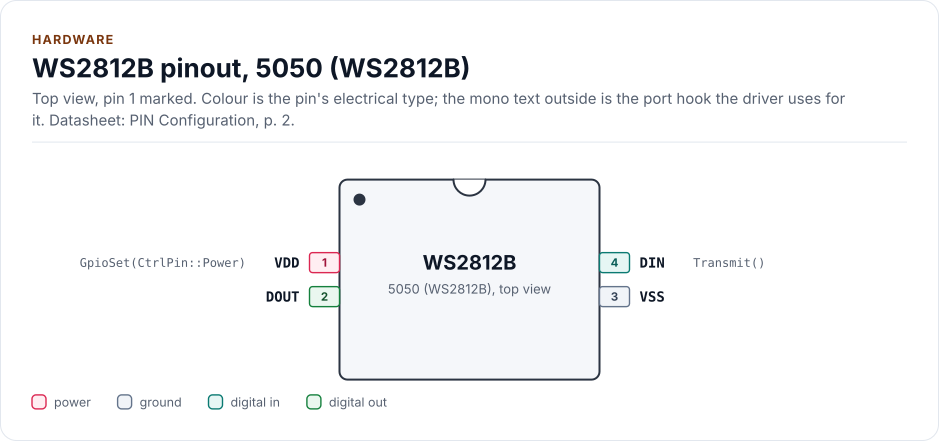
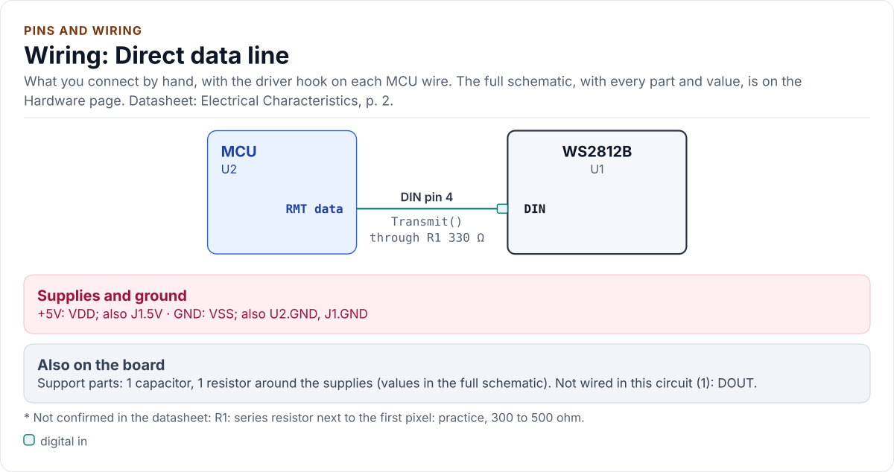
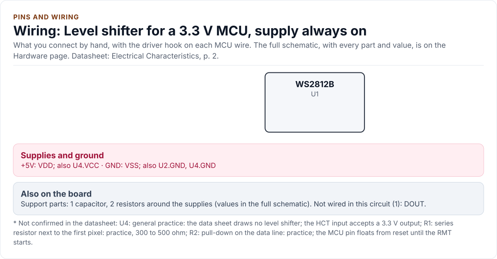
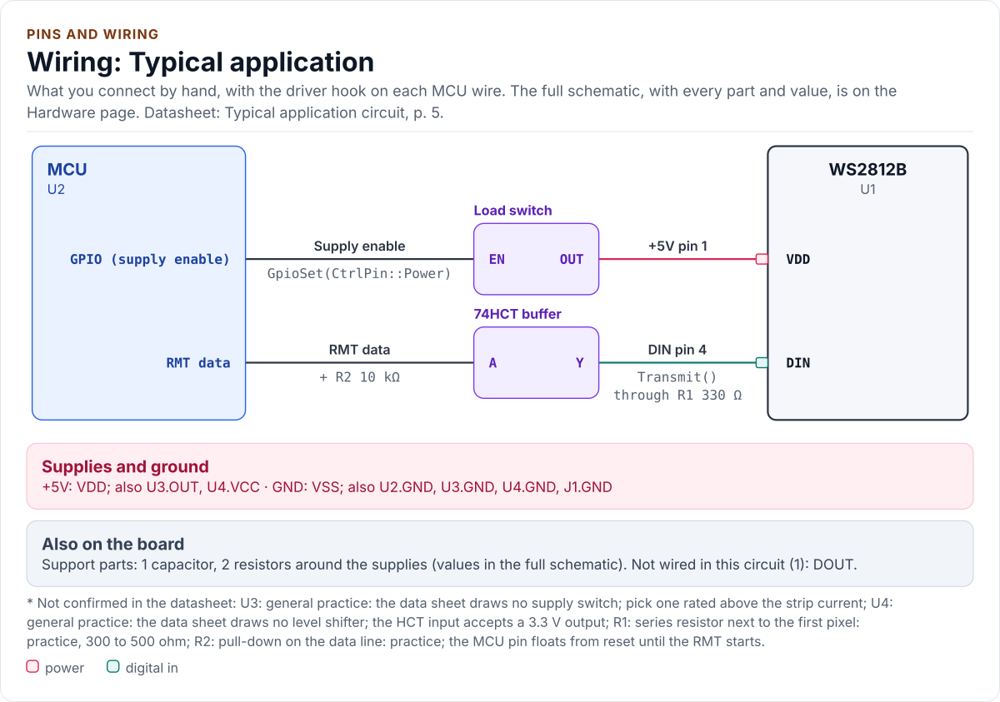
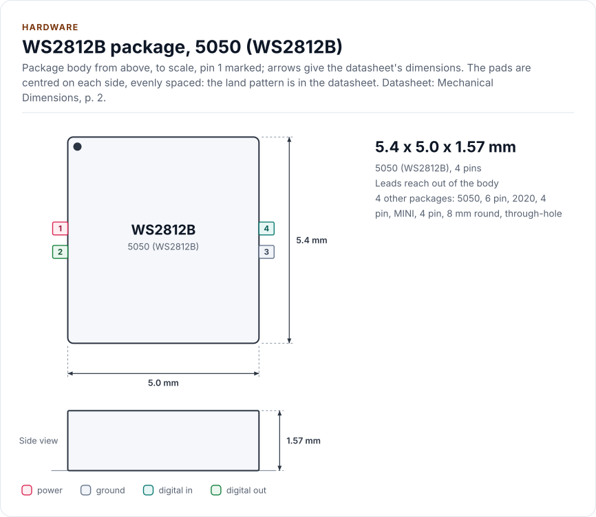
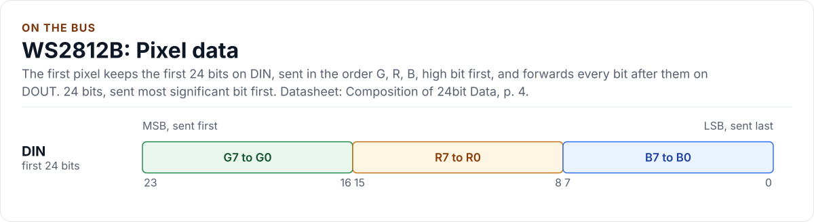

---
hide:
  - navigation
  - toc
---

<div class="kb-hero" markdown>
<span class="kb-kicker">Driver</span>

# WS2812_RMT Driver

<p>A C++20 driver for single-wire addressable RGB and RGBW LEDs (WS2812, SK6812 and compatible), sent as a timed
bit stream through a small port class.</p>

[Quickstart](quickstart.md){ .md-button .md-button--primary }
[API guide](api-guide.md){ .md-button }
[Source on GitHub](https://github.com/kokeb-labs-drivers/driver-ws2812-rmt){ .md-button }
</div>

<!-- generated: chip-summary -->
The **WS2812B** is an addressable RGB LED with its control circuit in one 5050 package: pixels chain on a single data
wire, each keeps the first 24 bits it receives for its three LEDs and passes the rest on to the next pixel (Features and
Benefits, p. 1).
<!-- /generated -->

<!-- figure: chip-hero -->
<picture>
  <source media="(prefers-color-scheme: dark)" srcset="diagrams/chip-hero.dark.svg">
   280 µs low time that latches a frame.">
</picture>
<!-- /figure -->

## What it does

<!-- figure: chip-capabilities -->
<picture>
  <source media="(prefers-color-scheme: dark)" srcset="diagrams/chip-capabilities.dark.svg">
  
</picture>
<!-- /figure -->

## Where it is used

<!-- generated: chip-uses -->
- Full-color modules
- LED full-color soft and hard light bars
- LED guardrail tubes
- LED decorative lighting
- LED screens, and indoor and outdoor irregular video screens
- Marquees on electronic products and electrical equipment

Uses named by the datasheet (Features and Benefits, p. 1).
<!-- /generated -->

## Inside the chip

<!-- figure: chip-blocks -->
<picture>
  <source media="(prefers-color-scheme: dark)" srcset="diagrams/chip-blocks.dark.svg">
  
</picture>
<!-- /figure -->

## Pins and wiring

<!-- figure: chip-pinout -->
<picture>
  <source media="(prefers-color-scheme: dark)" srcset="diagrams/chip-pinout.dark.svg">
  
</picture>
<!-- /figure -->

<!-- figure: chip-wiring-direct -->
<picture>
  <source media="(prefers-color-scheme: dark)" srcset="diagrams/chip-wiring-direct.dark.svg">
  
</picture>
<!-- /figure -->

<!-- figure: chip-wiring-shifted -->
<picture>
  <source media="(prefers-color-scheme: dark)" srcset="diagrams/chip-wiring-shifted.dark.svg">
  
</picture>
<!-- /figure -->

<!-- figure: chip-wiring-typical -->
<picture>
  <source media="(prefers-color-scheme: dark)" srcset="diagrams/chip-wiring-typical.dark.svg">
  
</picture>
<!-- /figure -->

<!-- figure: chip-outline -->
<picture>
  <source media="(prefers-color-scheme: dark)" srcset="diagrams/chip-outline.dark.svg">
  
</picture>
<!-- /figure -->

<!-- figure: chip-frame-pixel -->
<picture>
  <source media="(prefers-color-scheme: dark)" srcset="diagrams/chip-frame-pixel.dark.svg">
  
</picture>
<!-- /figure -->

The pin tables, the full schematic and the timing are on [Hardware](hardware.md).

## Quick start

Wire the chip as above, write the port for your MCU ([Porting](porting.md)), then:

<!-- generated: quickstart-code -->
```cpp
#include "ws2812_rmt.hpp"

// 60 pixels of a current WS2812B (V5 or later): the default variant, GRB order.
int32_t light_first_pixel_red() {
  MyPort port;
  ws2812_rmt::Ws2812Rmt<MyPort, 60> strip(port); // owns the pixel and wire buffers; no I/O yet
  if (auto r = strip.EnsureInitialized(); !r) { // 1. channel up, waveform resolved at the real rate
    return static_cast<int32_t>(r.error); //    Bus, or TimingUnreachable for an unsuitable rate
  }
  strip.Clear();                                                          // 2. all pixels black
  static_cast<void>(strip.SetPixel(0, ws2812_rmt::Colour{255, 0, 0, 0})); //    pixel 0 is the first
  if (auto r = strip.Show(); !r) {        // 3. encode, send, wait for the reset
    return static_cast<int32_t>(r.error); //    Bus: the frame was not sent
  }
  return 0;
}
```
<!-- /generated -->

Every step, with the port and what to check when it does not work: [Quickstart](quickstart.md).

## Driver coverage

<!-- generated: chip-coverage -->
| Capability | What the chip does | Driver API | Registers | Status | Datasheet |
| --- | --- | --- | --- | --- | --- |
| [24-bit pixel colour](colour.md) | Stores the colours and sends each pixel as G, R, B, high bit first; the colour order is a Config field | `SetPixel`, `GetPixel`, `Fill`, `Clear`, `kOrderGrb` | - | Supported | Composition of 24bit Data, p. 4 |
| Cascaded pixels | Sends a whole strip in one frame: each pixel keeps its 24 bits and forwards the rest | `Show`, `Length`, `kMaxPixels` | - | Supported | Data Transmission Method, p. 4 |
| [Bit timing](timing.md) | Turns the datasheet pulse windows into ticks of the rate your port really runs at, or refuses | `CurrentWaveform`, `ResolutionHz`, `Error::TimingUnreachable` | - | Supported | Data Transfer Time, p. 3 |
| [Frame latch](timing.md) | Ends a frame with a low longer than the reset time (above 280 µs on the V5 sheet) so the pixels latch | `Show`, `FrameTimeUs` | - | Supported | Data Transfer Time, p. 3 |
| [256 brightness levels](colour.md) | Scales the colours before sending, with an optional gamma table; the chip itself takes 8 bits per colour | `SetBrightness`, `SetGamma`, `Gamma::Gamma22` | - | Supported | Features and Benefits, p. 1 |
| Shared power source | Logic and LEDs share one supply, so the driver can switch the strip's supply from an MCU pin | `PowerOn`, `PowerOff`, `GpioSet`, `CtrlPin::Power` | - | Supported | Features and Benefits, p. 1 |
| [Other generations](timing.md) | Timing windows for the WS2812 and WS2812B generations, WS2812C and D, and SK6812 parts, or a Custom timing | `Variant`, `Variant::Custom` | - | Supported | PIN Configuration, p. 2 |
| [Input level](hardware.md) | DIN needs at least 2.7 V on the V5 sheet; the driver cannot see the level, so a level shifter is yours | - | - | Not covered | Electrical Characteristics, p. 2 |

**Supported**: the driver covers it and a host test checks it; **Not covered**: the chip has it and the driver leaves it
alone.

From [`docs/hardware.yml`](hardware.yml); `kokeb-docs hardware --check` confirms that every API name is in
`inc/ws2812_rmt.hpp`, `inc/ws2812_rmt_types.hpp`, `inc/ws2812_rmt_functions.hpp`, `inc/ws2812_rmt_gpio_interface.hpp`.
<!-- /generated -->

The core is platform-free: it keeps the pixels, encodes the byte stream and works out the waveform from the
datasheet windows and the tick rate your port really runs at. The port sends the bytes. On ESP32 that is the RMT
transmitter, and the repository ships that port as an example.

!!! note "MCU-bound through the port"
    The driver needs a peripheral that can send a timed bit stream (`bus: pio` in `driver.yml`). On ESP32 that is
    the RMT transmitter. On another MCU you write a port over its own peripheral: [Porting](porting.md).

## What you get

- **One object per strip**, with a fixed capacity and no heap. No I/O until `EnsureInitialized()`.
  See [API guide](api-guide.md).
- **The right waveform for your part.** A named variant per datasheet generation, or your own windows with `Custom`.
  A waveform outside the windows cannot reach the wire. See [Timing](timing.md).
- **Errors you can act on**: `Result<T>` with an `Error`. See [Contract](contract.md).
- **Colour order, brightness and gamma** as data, not code. See [Colour](colour.md).
- **Tested without hardware** against a model written from the datasheets. See [Testing and CI](testing.md).

## Datasheet

<!-- generated: datasheet-card -->
| Document | Revision | Get it |
| --- | --- | --- |
| Datasheet: WS2812 (6 pin) (Worldsemi WS2812) | undated, 2012-10 | [mirror](https://cdn.sparkfun.com/datasheets/Components/LED/WS2812.pdf) |
| Datasheet: WS2812S (6 pin) (Worldsemi WS2812S) | undated, 2013-12 | [mirror](https://static.chipdip.ru/lib/011/DOC013011924.pdf) |
| Datasheet: WS2812B (Worldsemi WS2812B) | undated, 2013-05 | [mirror](https://cdn-shop.adafruit.com/datasheets/WS2812B.pdf) |
| Datasheet: WS2812B (Chinese-language edition) (Worldsemi WS2812B) | undated, 2013-12 | [mirror](https://atta.szlcsc.com/upload/public/pdf/source/20170703/1499049112282.pdf) |
| Datasheet: WS2812B (Worldsemi WS2812B) | Mar-2017, 2017-03 | [mirror](https://www.triopak.fi/files/product/Worldsemi/WS2812B.pdf) |
| Datasheet: WS2812B Ver. No. V5 (Worldsemi WS2812B-V5) | V5.0, 2019-03 | [mirror](https://cdn.eicom.ru/media/PDF/WS2812B-V5.pdf) |
| Datasheet: WS2812B Ver. No. V5 (Watterott copy, revision V6.1) (Worldsemi WS2812B-V5) | V6.1, 2022-09 | [mirror](https://learn.watterott.com/kb/ws281x/WS2812B-v5.pdf) |
| Datasheet: WS2812B-V5/W (Hestore copy, revision V6.0) (Worldsemi WS2812B-V5/W) | V6.0, 2021-12 | no mirror recorded |
| Datasheet: WS2812B-1313-V6 (1313 package) (Worldsemi WS2812B-1313-V6) | V1.0, 2025-10 | no mirror recorded |
| Datasheet: WS2812B-V6 (Worldsemi WS2812B-V6) | V1.1, 2025-10 | [mirror](https://atta.szlcsc.com/upload/public/pdf/source/20251201/45CD695EA06F90F53A3AC4760AC4DC7D.pdf) |
| Datasheet: WS2812B-2020 (Worldsemi WS2812B-2020) | V1.2, 2018-12 | [mirror](https://static.chipdip.ru/lib/471/DOC047471401.pdf) |
| Datasheet: WS2812C (5050, 5 mA) (Worldsemi WS2812C) | V1.0, 2017-05 | [mirror](https://static.chipdip.ru/lib/011/DOC013011928.pdf) |
| Datasheet: Document headed WS2812C, body text WS2812B (Worldsemi WS2812C) | V1.4, 2018-07 | [mirror](https://static.chipdip.ru/lib/622/DOC047622372.pdf) |
| Datasheet: WS2812C-2020 (Worldsemi WS2812C-2020) | V1.0, 2019-03 | [mirror](https://akizukidenshi.com/goodsaffix/ws2812c-2020.pdf) |
| Datasheet: WS2812-2020 (Worldsemi WS2812-2020) | V1.0, 2018-05 | [mirror](https://cdn.shopify.com/s/files/1/2386/9605/files/WS2812-2020_V1.0_EN.pdf) |
| Datasheet: WS2812D-F8 15 mA (8 mm round) (Worldsemi WS2812D-F8) | V1.1, 2018-04 | [mirror](https://static.chipdip.ru/lib/471/DOC047471333.pdf) |
| Datasheet: SK6812 (RGB, 5050) (Opsco SK6812) | Rev. 01, 2015-05 | [mirror](https://cdn-shop.adafruit.com/product-files/1138/SK6812+LED+datasheet+.pdf) |
| Datasheet: SK6812RGBW (Opsco SK6812RGBW) | Rev. 01, 2015-07 | [mirror](https://cdn-shop.adafruit.com/product-files/2757/p2757_SK6812RGBW_REV01.pdf) |
| Datasheet: SK6812RGBX-XX (RGBW) (Opsco SK6812RGBX-XX) | Rev. 03, 2018-07 | [mirror](https://www.ledyilighting.com/wp-content/uploads/2022/02/SK6812-RGBW-LED-specification.pdf) |
| Datasheet: SK6812RGBX-XX (Opsco SK6812RGBX-XX) | Rev. 07, 2019-01 | [mirror](https://ge.voron.ua/files/pdf/Addressed_LEDs/SK6812RGBW-BW/SK6812RGBX-XX_Datasheet.pdf) |
| Datasheet: SK6812MINI-E (Opsco SK6812MINI-E) | Rev. 02, 2019-01 | [mirror](https://cdn-shop.adafruit.com/product-files/4960/4960_SK6812MINI-E_REV02_EN.pdf) |
| Datasheet: SK6812MINIRGBX-XX (mini RGBW) (Opsco SK6812MINIRGBX-XX) | Rev. 01, undated, 2022-11 | [mirror](https://datasheet.sic-components.com/CSPM1411RGBW-IC-6.pdf) |

Written against these revisions; the SHA-256 of each file is in [`docs/datasheets.yml`](datasheets.yml). Where each part
of the driver is in the datasheet: [Datasheet map](datasheet.md).
<!-- /generated -->
